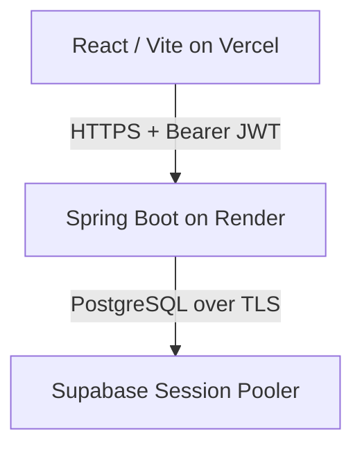

# Task Management System

A full-stack TaskFlow application for managing personal projects and tasks. The Vietnamese React interface provides a dashboard, project/task management, an All Projects task list and a Kanban board. Spring Boot enforces ownership, session-backed JWT authentication and database integrity.

Backend: [Render API](https://task-management-system-i7xu.onrender.com), [Swagger](https://task-management-system-i7xu.onrender.com/swagger-ui/index.html), [health](https://task-management-system-i7xu.onrender.com/api/health). The public health/OpenAPI endpoints were reachable during FE-08; unauthenticated protected requests returned 401. **Existing frontend:** [TaskFlow on Vercel](https://frontend-eight-tawny-fm551jojda.vercel.app). Its six routes returned SPA HTML during read-only checks; the served assets differ from the reviewed local FE-08 build. Deploying the FE-08 changes and production CRUD verification remain pending authorization/access. No deployment by this task is claimed. The original brief is in [docs/assignment.md](docs/assignment.md).



## Technology stack

React 19, Vite 8, JavaScript, Tailwind CSS 4, React Router, Axios, TanStack Query, Sonner and dnd-kit; Java 21, Spring Boot 3.5.16, Maven, Spring Data JPA/Hibernate, Spring Security/BCrypt, signed HS256 JWTs, PostgreSQL/Supabase, Flyway, Lombok, springdoc-openapi, JUnit 5/Mockito, Testcontainers PostgreSQL and a multi-stage Java 21 Docker image.

## Implemented features

- Responsive login/register, protected navigation, current-user identity and session-specific logout. Same-tab reload restores an unexpired token through a mandatory `/api/auth/me` check.
- Project management; task CRUD, filters/sorting/pagination and a combined All Projects view that loads every required backend page with at most three task reads concurrently.
- Kanban drag-and-drop with keyboard controls, optimistic status updates, task-local rollback and a task details/edit drawer. Archived projects remain read-only for tasks.
- Real-API dashboard, shared query caches, background updates without full-page loading, session-isolated caches and one global Sonner Toaster at top-right.
- Normalized-email registration/login, BCrypt passwords, current-user endpoint and session-specific logout/revocation. Only hashed session tokens are persisted.
- Owned project CRUD and archive; task CRUD/status changes/moves, case-insensitive title search, status/priority filters, bounded pagination and validated sorting.
- Database-managed completion/update timestamps, integrity constraints, cascading task deletion and archived-project task-write protection.
- Dashboard status totals/completion percentage, upcoming/overdue task pages and optional owned-project filtering.
- Backend ownership predicates plus forced RLS with transaction-scoped identity. Foreign resources return 404; unauthenticated requests return 401.
- Shared error DTOs, environment-configured CORS, Swagger UI, unit/integration tests, Java 21 Docker packaging and deployment instructions.

## Not implemented

Refresh tokens/HttpOnly-cookie renewal (login is required after JWT expiry), password reset/email verification, team sharing/roles, push notifications, bulk operations, a server-side global task-list endpoint, production rate-limit infrastructure and CI/CD automation. Deployment of the reviewed FE-08 changes and the production write smoke journey remain pending authorization/access. Docker/Testcontainers execution still requires an available Docker daemon; local PostgreSQL integration is verified separately.

## Local setup

1. Install JDK 21 and set JAVA_HOME. Maven Wrapper is included; Docker is optional for container tests.
2. Copy `backend/.env.example` to a private local environment file and replace placeholders.
3. Export those variables into the launching process or use your IDE's environment configuration. Spring Boot **does not automatically load .env files**. Never commit them.
4. Provide a disposable/local PostgreSQL database or a separately authorized development Supabase database. Migrations need DDL permissions; use the separate migration procedure for production.
5. From `backend/`, run:

```bash
./mvnw spring-boot:run
```

PowerShell: `.\mvnw.cmd spring-boot:run`. Verify `http://localhost:8080/api/health` (adjust for PORT).

Missing DB variables, an unreachable database or invalid credentials prevent startup. Invalid JWT key/lifetime settings also fail startup. There is no fallback database or embedded production credential.

Generate a new Base64 key locally, for example:

```bash
openssl rand -base64 32
```

Store its output privately as JWT_SECRET; do not reuse any test signing key. Password/token values should never be placed in URLs or logs.

## Environment variables

For the frontend, copy `frontend/.env.example` only when creating a new private configuration, run `npm install` then `npm run dev` from `frontend/`. Node 22.17.0 was used for verification. For local backend development, set `VITE_API_BASE_URL=http://localhost:8080` and backend `FRONTEND_URL=http://localhost:5173`; Vite uses port 5173. For the deployed backend, the public build-time value is `VITE_API_BASE_URL=https://task-management-system-i7xu.onrender.com`. The value must be an origin without `/api`, credentials, query or fragment. Changing a Vite environment variable requires rebuilding. See [frontend README](frontend/README.md) for full setup.

| Variable | Purpose/default |
| --- | --- |
| `VITE_API_BASE_URL` | Frontend only: public backend origin. All `VITE_*` values are visible to browsers; never include DB credentials, JWT signing secrets or access tokens. |
| `PORT` | HTTP port; local default 8080, use Render's supplied value in deployment. Bound on 0.0.0.0. |
| `DB_URL` | Required JDBC URL, e.g. `jdbc:postgresql://YOUR_SESSION_POOLER_HOST:5432/postgres?sslmode=require`. No credentials in URL. |
| `DB_USERNAME`, `DB_PASSWORD` | Required runtime database role credentials. On the Supabase pooler use the role/project-ref username shown by Connect. |
| `DB_POOL_SIZE` | Maximum connections per instance; default 5, minimum idle 1. Budget against Supabase limits. |
| `FRONTEND_URL` | One exact CORS origin; default http://localhost:3000. Example file uses React/Vite localhost:5173. Production: the actual Vercel/custom-domain origin, no trailing slash. |
| `JWT_SECRET` | Required Base64 random key, at least 32 decoded bytes. |
| `JWT_EXPIRATION` | Milliseconds, default 900000; allowed 60000?3600000. |
| `FLYWAY_ENABLED` | Local startup migrations default true. Set false on production web instances after separate migration. |
| `FLYWAY_DB_URL`, `FLYWAY_DB_USERNAME`, `FLYWAY_DB_PASSWORD` | Separate migration role. The migration-only command requires all three; local startup Flyway falls back to DB variables if absent. |
| `DASHBOARD_TIME_ZONE` | Calendar-date boundary zone; default UTC, e.g. Asia/Ho_Chi_Minh. |
| `API_DOCS_ENABLED` | Enables OpenAPI/Swagger UI; default true. Can disable publicly in production. |
| `JAVA_TOOL_OPTIONS` | Optional JVM tuning; Docker defaults to MaxRAMPercentage=65.0. Keep secrets out of JVM arguments. |

SSL: use Session Pooler **5432**, not transaction pooler 6543. `sslmode=require` encrypts the connection; `verify-full` with the Supabase CA verifies the server/hostname. See [deployment instructions](backend/docs/deployment.md) for exact connection and certificate setup.

## Database migrations and ownership

Migrations live in `backend/src/main/resources/db/migration`:

- V1: users, sessions, projects and tasks, UUIDs, native enums, constraints/indexes, timestamp/completion triggers, forced ownership RLS.
- V2: transaction-local, exact-email SELECT policy for the trusted backend's password-verification bootstrap.

Hibernate stays `ddl-auto=validate`; SQL auto-initialization and Flyway clean are disabled. No demo accounts/seed data run at startup. The optional local seed script requires an existing development user and is outside Flyway locations.

Never edit applied migrations or enable automatic baselining for an existing Supabase schema. Inspect existing objects first. Forced RLS does not protect against superuser/BYPASSRLS roles or a backend that sets unverified identity; the runtime must be a dedicated nonowner role with only needed DML grants. Services derive identity from the verified JWT inside each transaction.

For production, migrate before starting the web release using the dedicated migration role, then grant runtime access and set FLYWAY_ENABLED=false. The image's migration-only command is:

```text
java -Dloader.main=backend.config.DatabaseMigration -cp /app/app.jar org.springframework.boot.loader.launch.PropertiesLauncher
```

Full permissions, first-run grants and adoption restrictions: [database design](backend/docs/database-design.md) and [deployment procedure](backend/docs/deployment.md).

## API documentation

- Health: `GET /api/health` is public liveness (not a continuous database readiness probe).
- Swagger UI: `/swagger-ui.html`; OpenAPI JSON: `/v3/api-docs` when enabled.
- Register/login are public POSTs; `/api/auth/me`, logout and business APIs require an active session-backed Bearer JWT.
- Use Swagger Authorize with the accessToken only. Logout invalidates that session's JWT; other sessions remain active. No refresh endpoint is implemented.
- CORS accepts the configured origin and explicit bearer headers; cookies, HTTP Basic and form login are not authentication mechanisms.

Contracts: [authentication](backend/docs/authentication.md), [projects](backend/docs/projects.md), [tasks](backend/docs/tasks.md), [dashboard](backend/docs/dashboard.md), [OpenAPI/testing](backend/docs/api-documentation-and-tests.md).

## Testing and build

Frontend checks from `frontend/`:

```powershell
npm install
npm test
npm run lint
npm run build
```

Optional browser tooling: `npm install --no-save --package-lock=false playwright`. With a production preview running on `127.0.0.1:4173`, run `node scripts/performance-smoke.mjs` and `node scripts/all-projects-smoke.mjs`; these scripts intercept backend HTTP traffic and never write production data.

For a real browser/API/database integration check on Windows, from the repository root:

```powershell
.\scripts\Test-FrontendIntegration.ps1
```

This requires JDK 21, local PostgreSQL binaries and the optional Playwright package/Microsoft Edge. It packages the actual backend, creates an isolated loopback PostgreSQL cluster, runs the existing V1/V2 migration entry point with a migration role, starts Spring Boot as a separate nonowner runtime role and builds a separate local-only frontend under ignored `node_modules/.cache`. It tests registration/login, reload restoration, project/task management, All Projects, Kanban, dashboard, ownership, expiration, logout and responsive layouts. All write targets are loopback; a temporary random signing key is never printed. Child services stop and environment variables restore in `finally`. Logs/database files remain under ignored `backend/target/fe08-e2e-*`; no production URL or credentials are loaded by the harness. The production `frontend/dist` output is preserved.

Security scan from the repository root: `node scripts/check-secrets.mjs`. It checks indexed and working tracked files plus new nonignored files for selected credential patterns, reporting paths/categories only. This is a targeted scan, not a guarantee about every possible secret format or the complete Git history.

From `backend/`:

```bash
./mvnw clean verify
```

This compiles, tests and packages the executable JAR in `target/`. Database tests prefer a new Testcontainers PostgreSQL instance when Docker is available. If Docker and an isolated local override are both unavailable, integration tests skip; a successful Maven exit alone does not mean those tests executed.

Windows fallback using installed local PostgreSQL binaries:

```powershell
.\scripts\Test-Postgres.ps1
```

It creates/stops a disposable loopback cluster and runs all tests without production DB variables or .env files. Only the exact loopback task2_test URL is accepted as an explicit test override. Fixtures truncate disposable data; do not redirect/tunnel tests to production. Tests cover auth/session revocation, ownership/RLS, validation/errors, CRUD/search/filters, date boundaries/query counts, OpenAPI and V1?V2 data-preserving upgrade. See [test setup/results](backend/docs/api-documentation-and-tests.md).

Docker build from repository root:

```bash
docker build -t task-management-backend ./backend
docker run --rm --env-file backend/.env -p 8080:8080 task-management-backend
```

Unlike Spring Boot itself, Docker's --env-file explicitly loads the file. Use PORT=8080 for this mapping, and a database reachable from inside the container (localhost refers to the container). Tests run separately; image builds contain only main sources and do not connect to any database. The runtime is a nonroot Java 21 JRE. `.dockerignore` excludes environment files, Git data, tests, build outputs and key files.

## Render / Supabase / Vercel deployment

Use the **intended existing Vercel project**, after deployment authorization and account/team access are available. No project link or Vercel CLI login was found on this workstation during preparation. The reviewed working branch is `chore/frontend-deployment`; the starting revision was `caa44ce`. Changes prepared by FE-08 are uncommitted. Do not deploy a different branch or an old commit merely because an earlier build passed.

| Vercel setting | Required value |
| --- | --- |
| Root Directory | `frontend` |
| Framework Preset | Vite |
| Install Command | `npm install` (or `npm ci` with the committed lockfile) |
| Build Command | `npm run build` |
| Output Directory | `dist` |
| Production environment | `VITE_API_BASE_URL=https://task-management-system-i7xu.onrender.com` |

`frontend/vercel.json` supplies the framework/build/output settings and SPA fallback to `/index.html`. Its location is correct relative to Root Directory `frontend`; do not change the root to `backend` or repository root without adjusting the deployment configuration. Environment variables are baked into the build. [Vercel Vite guide](https://vercel.com/docs/frameworks/frontend/vite), [environment variables](https://vercel.com/docs/environment-variables).

1. Review the diff and local verification. The user must authorize the deployment and identify the existing Vercel project/team. If using Git deployment, the user must publish the reviewed source themselves; this task does not push, merge or force-push.
2. In that existing project's Settings, set the table values above and add the public API variable for Production. Build/redeploy the approved revision. If Vercel asks for sign-in or team permissions, complete that in your browser; do not paste access tokens into chat or Git.
3. The user supplied the existing domain `https://frontend-eight-tawny-fm551jojda.vercel.app`; confirm the authorized deployment belongs to that project/team and retains the intended domain.
4. In the existing Render backend's Environment settings, set `FRONTEND_URL` to that **exact HTTPS origin**, without path or trailing slash. `SecurityConfig` already allows Authorization/Content-Type and GET, POST, PUT, PATCH, DELETE, OPTIONS with credentials disabled; no CORS code change is needed. Avoid `*` or unrestricted `*.vercel.app`. Preview deployments need separately reviewed origins because the backend supports one configured origin.
5. Changing Render environment values requires applying them through a deploy. Do this only with backend-redeploy authorization; “Save only” does not activate the change. Never alter DB/JWT secrets to solve a CORS failure. [Render environment behavior](https://render.com/docs/configure-environment-variables).
6. From the actual production frontend origin, verify preflight and authenticated requests in browser DevTools. A local preview/CORS test is not proof of production CORS. Directly open and refresh `/login`, `/register`, `/dashboard`, `/projects`, `/tasks`, `/kanban`; protected routes should restore an active same-tab session or redirect safely to login.
7. Only after separate permission to write disposable production test data, run Register → Login → Create Project → Create Task → All Projects/filters → Edit Task → Kanban drag → Refresh → Dashboard → Logout. Record observed outcomes and clean up only the authorized test records. Until then, production CRUD and authenticated browser checks remain **not executed**.

The existing backend uses a Docker Web Service, health path `/api/health`, Render's `PORT`, SSL PostgreSQL Session Pooler and environment JWT/CORS settings. Keep migration credentials separate from runtime, keep `FLYWAY_ENABLED=false` on production web instances and Hibernate `ddl-auto=validate`. Do not run migrations again as part of frontend deployment, edit V1/V2, or provision/change Supabase without separate authorization.

See [detailed deployment instructions](backend/docs/deployment.md) for paid-plan pre-deploy limitations, migration-only invocation, SSL/CA handling, runtime privileges, rollback considerations and troubleshooting.

## Source layout

`frontend/src` contains api, components, contexts, hooks, layouts, pages, query and routes; `frontend/tests` holds unit/cache tests and `frontend/scripts` holds optional browser checks. `backend/src/main/java/backend` contains config, controller, service, repository, entity, dto, security, exception, mapper and enums layers; migrations are under src/main/resources and tests under src/test. Root `scripts` contains secret scanning and the disposable full-stack integration harness. The original assignment is under `docs/assignment.md`; implementation details are in both frontend and backend documentation.

## Delivery status

Backend tasks 1–8, frontend features and the All Projects/performance follow-ups are implemented. FE-08 local integration and deployment preparation are recorded here; deployment of FE-08 to the existing frontend, production CORS verification and the production write journey remain pending explicit authorization/access. Public production health/OpenAPI and unauthenticated 401s were checked without credentials. No production data was created, modified or deleted by this task.

Same-tab reload persistence stores only the bearer token and its expiration in `sessionStorage`, scoped to the API origin, then verifies `/api/auth/me` before rendering protected content. It is not a refresh-token mechanism, and no password, signing secret or query cache is persisted. JavaScript-readable bearer storage remains exposed to XSS; avoid third-party scripts/untrusted HTML and use an HttpOnly refresh-cookie design in a separately scoped future change if stronger persistence protection is needed. Storage denial falls back to memory-only login. Duplicating a tab can copy its sessionStorage; logout still revokes that session server-side. Cross-tab automatic sign-out is not implemented.

Other known limits: All Projects downloads the complete owned task collection before global pagination, so very large accounts need a future backend global-list endpoint; project search currently filters the loaded project page; no realtime subscriptions update other browsers; Render cold starts/network timeouts can delay the first request; Docker/Testcontainers execution still needs a working daemon. Local PostgreSQL verification does not certify the deployed Supabase privileges/schema or actual Vercel browser CORS.

### FE-08 verification record — 2026-11-23

| Check | Actual result |
| --- | --- |
| Frontend `npm install` | Completed; zero vulnerabilities reported by npm |
| Frontend unit/cache tests | 134 passed; zero failures/skips |
| ESLint / Vite production build | Passed; main JS ~479 kB raw / 149 kB gzip, lazy Kanban ~116 kB / 38 kB |
| Backend `Test-Postgres.ps1`, Java 21 | 72 passed; zero failures/errors/skips on disposable local PostgreSQL 18.7 |
| Real local full-stack browser harness | Four groups passed: auth/reload/direct routes; projects/tasks/All Projects/dashboard; real pointer drag/status persistence/drawer/responsive; task delete/ownership/project archive/delete/logout/expired JWT |
| Existing mocked browser regressions | Six performance groups and four All Projects groups passed; all external traffic intercepted |
| Secret scan | 232 tracked paths, index plus working tree, and five new paths; zero selected-pattern findings |
| Additional logging/history checks | No literal JWT found in the latest isolated backend logs; no private environment/key filenames found in the checked Git history path patterns |
| Public production backend | Health 200 with UP; OpenAPI 200; `/api/auth/me` and `/api/projects` without credentials returned 401 |
| Existing production frontend | User-supplied Vercel domain: six routes returned HTTP 200 SPA HTML; main asset uses the expected Render API origin and differs from the current local build |
| Production CORS / authenticated production CRUD | Follow-up backend HTTP probes timed out; browser fetches from the supplied Vercel origin failed with TypeError for health/me. This does not distinguish CORS rejection from network/backend failure. No authenticated production CRUD executed |

The local full-stack run applied existing V1/V2 to a fresh disposable database as the migration owner, then ran the app as the restricted nonowner runtime role. Hibernate validation passed. Local PostgreSQL 18 emits the existing Flyway tested-version-range warning; this is not a Supabase compatibility certification. The harness stopped its Java, Vite and PostgreSQL processes. Its logs are under ignored `backend/target/fe08-e2e-*`; backend test output is `backend/target/fe08-postgres.log`, frontend unit output is ignored `frontend/node_modules/.cache/fe08-unit.log`.

Integration fixes: verified same-tab session restoration was missing; drawer deletion could null out a live task before its confirmation completed, crashing the application; the global error fallback was still English; root/frontend documentation still described placeholders and an absent frontend. These are corrected. No backend source, database migration or dependency change was required. Vercel's existing configuration was inspected and retained because it already supplies the required SPA rewrite/build settings.

Files changed:

- Authentication: `frontend/src/api/tokenStore.js`, new `createTokenStore.js`, `frontend/src/contexts/createAuthSession.js`, `frontend/src/hooks/useAuthForm.js`, new `frontend/tests/sessionStorage.test.js`.
- UI/cleanup: `frontend/src/components/kanban/TaskDrawer.jsx`, `frontend/src/components/AppErrorBoundary.jsx`, `frontend/index.html`; removed unused `frontend/src/components/PlaceholderPage.jsx`.
- Verification: new `frontend/scripts/local-integration.mjs`, `scripts/Test-FrontendIntegration.ps1`, `scripts/check-secrets.mjs`; updated mock fixtures in `frontend/scripts/performance-smoke.mjs` and `all-projects-smoke.mjs` to handle restored `/api/auth/me` reads.
- Documentation/configuration examples: this `README.md`, `frontend/README.md`, `frontend/.env.example`; historical notices in `frontend/docs/application-layout.md`, `dashboard.md`, `tasks.md`, `kanban.md`.

Remaining release actions: obtain explicit deployment authorization and the intended existing Vercel project/team; authenticate and deploy the reviewed source; confirm the supplied frontend domain belongs to the intended project; authorize/apply `FRONTEND_URL=https://frontend-eight-tawny-fm551jojda.vercel.app` on Render if needed; verify SPA refresh and CORS in that actual production browser; obtain separate permission for the disposable production write journey. No push, merge, deployment, backend redeploy or production data modification was performed.
